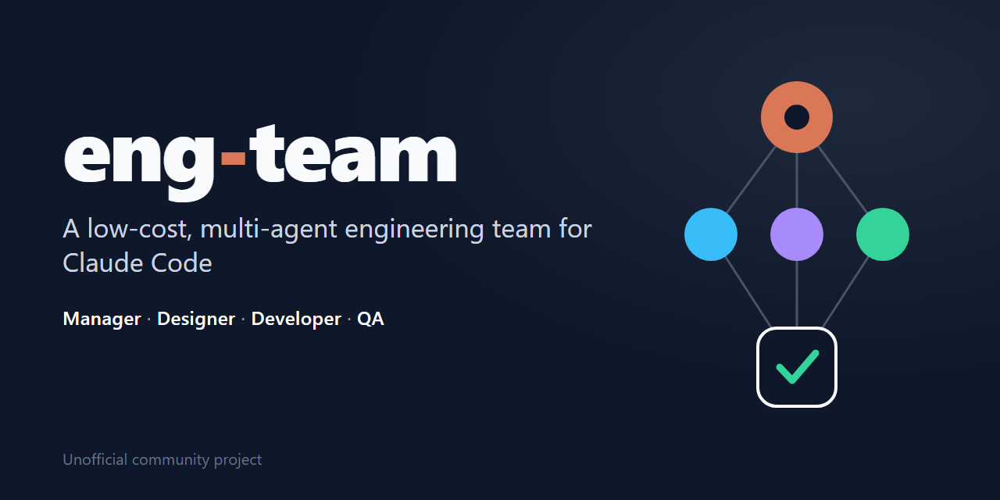
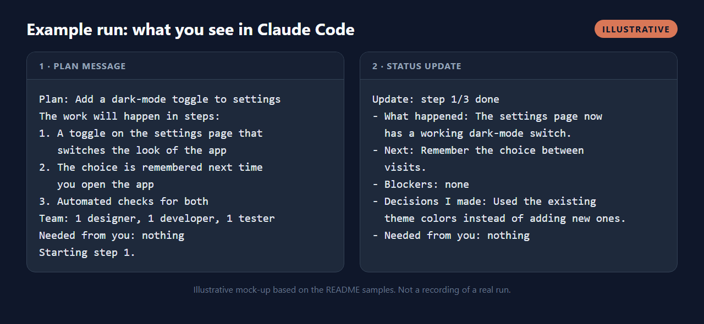
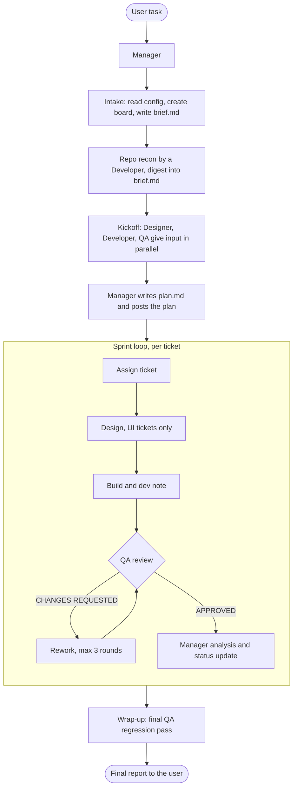
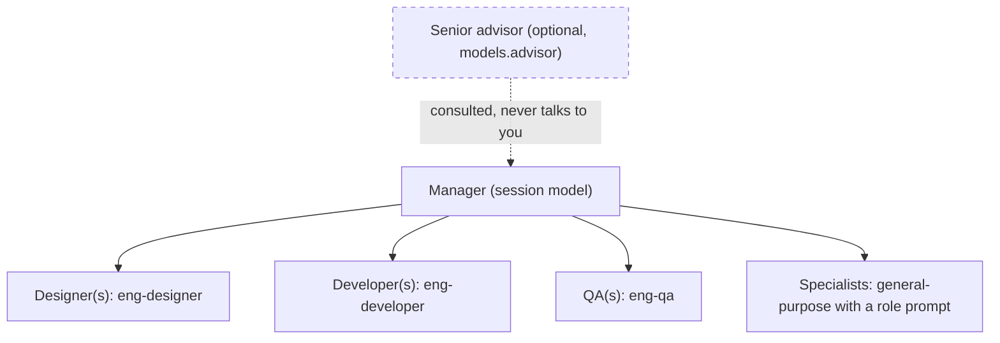

<div align="center">

# 🧑‍💻 eng-team: an AI engineering team for Claude Code



**eng-team is a multi-agent engineering team on GitHub for Claude Code: a skill and plugin that runs Manager, Designer, Developer and QA subagents like a real team.**
Hand it a broad task. A Manager plans it, a Designer, Developer and QA build it, and nothing is "done" until QA approves.
**Main motive: a low-cost, efficient team, with maximum quality at minimum AI cost.**

[](LICENSE)
[](#install)
[](CHANGELOG.md)

</div>

> [!NOTE]
> Unofficial community project. Not affiliated with, endorsed by, or sponsored by Anthropic.

**eng-team** (the "eng team" for Claude) is a Claude Code skill and plugin, hosted here on GitHub, that turns Claude Code into a small, multi-agent engineering team. A Manager (the skill) plans the work into tickets, and Designer, Developer and QA subagents carry them out, with a QA gate before anything counts as done. It is designed to keep token cost low while keeping quality high.

**Install in one minute** (inside Claude Code):

```
/plugin marketplace add moiz7-dev/eng-team
/plugin install eng-team@eng-team-marketplace
```

Then run `/eng-team <your task>`. More options: [Install](#install).

**What is it?**
- A Claude Code skill (`/eng-team`) plus three subagents: Designer, Developer and QA.
- A ticket-based agentic workflow with a shared Markdown team board.
- Safe by default: no commit, push or deploy without asking.

**Who is it for?**
- Claude Code users who want broad tasks planned, built and reviewed, not just answered.
- Solo developers, founders and non-coders who want plain-language progress updates.
- Anyone who wants to use subagents without burning tokens on repeated exploration.

**Use cases**
- Building a multi-step feature end to end (plan, design, code, tests, review).
- Refactors or fixes that touch several files and need an independent QA pass.
- Getting a structured plan and acceptance criteria before any code is written.

<a id="strengths"></a>
## ⭐ Key strengths

| # | Strength | What it means |
|---|---|---|
| 1 | 👥 **Full team in one place** | You give a task; the Manager splits it into tickets; the Designer, Developer and QA each do their part. |
| 2 | ✅ **Nothing is "done" without QA** | An independent QA reviews every ticket. Failures go back to the developer, with a maximum of 3 rework rounds. |
| 3 | 🗣️ **No code knowledge needed** | Updates are in plain language: what happened, what is next, what needs you. Technical detail stays on the team board. |
| 4 | 🔒 **Safe by default** | No commit, push, deploy or payment without asking. Risky behaviours are opt-in via config. Payments, legal agreements, credentials, public posts and account deletion always ask, whatever the config says. |
| 5 | 🏆 **Low token cost, same quality** | **The headline: maximum quality at minimum AI cost.** The repo is explored once and shared as a digest, briefs point to files instead of pasting them, and the process scales to the task. QA and tests are never cut. See [Built to be cheap to run](#cheap). |

> [!IMPORTANT]
> **Our main motive: a low-cost, efficient team.** eng-team is built to give you maximum quality at minimum AI cost. It cuts waste (repeated exploration, pasted context, oversized process), never QA, tests or acceptance criteria.

Bonus: works with any language or stack, and with the model tiers you configure. Two install methods: plugin or manual copy (see [Install](#install)).

<a id="cheap"></a>
### 🏆 Built to be cheap to run

Each technique below comes from the "Token efficiency" section of [`skills/eng-team/SKILL.md`](skills/eng-team/SKILL.md). Quality gates are never cut; only waste is.

| Technique | How it saves tokens |
|---|---|
| One shared repo digest | After recon, `brief.md` holds a digest of about 40 lines (stack, commands, folder map, conventions). Every member reads it instead of re-exploring the repo; recon never runs twice. |
| Point, do not paste | Briefs give board and exact file paths and inline only the few lines that are new. No whole files, plans or earlier reports pasted into prompts. |
| Cache-friendly fixed briefs | Every brief starts with the same fixed block and puts the ticket-specific part last, so prompt caching can reuse the prefix. Parallel members are spawned in one message. |
| Scale of process matches task size | A tiny or small task gets no kickoff, one Developer, one QA and one ticket. Tiny related tickets are merged to avoid micro-ticket briefing overhead. |
| Short reports, detail on the board | Members return about 150 words and keep full detail in their board file. The Manager reads the summary and the `VERDICT` line first. |
| Targeted reads and tests | Grep first, then line ranges; narrowest test while iterating, full suite once at the end of the ticket. |
| Rework discipline | Brief it right the first time; on rework send only the specific findings. A looping member is stopped and re-briefed. |
| Optional senior advisor, only when needed | A stronger model is consulted only when the confidence gate shows real doubt (hard plan, stuck problem), normally once per task, and only if `advisor` is on. |
| Model tiers | A cheap tier (default `haiku`) is allowed for truly trivial tasks only, never for real features, QA verdicts or risky work. |

## ✨ Why eng-team

- 🧭 **Plans before it builds.** Intake, repo recon, a kickoff meeting, then a ticket plan with acceptance criteria.
- ✅ **QA gate.** Every ticket gets a strict review and a `VERDICT: APPROVED` or `VERDICT: CHANGES REQUESTED`. Max 3 rework rounds.
- 🔒 **Safe by default.** Commits, pushes, deploys and destructive actions ask you first unless you opt in.
- 🗂️ **Shared team board.** Subagents cannot talk to each other, so they share Markdown files under `.eng-team/<task-slug>/`.
- 💸 **Built to be cheap (our main motive).** One shared repo digest, short reports, scaled ceremony, configurable model tiers, and never a cut to QA or tests. See [Built to be cheap to run](#cheap).
- 🗣️ **Client-friendly updates.** Plain-language status after every ticket (or `tone: technical` if you are an engineer).

## 📑 Table of contents

| | |
|---|---|
| [⭐ Key strengths](#strengths) | Five strengths, and why it is cheap to run |
| [🎬 Example run](#example-run) | An illustrative plan and status update |
| [🚀 Quickstart](#quickstart) | Three copy-paste prompts |
| [🔌 Install](#install) | Plugin or manual, update, uninstall, verify |
| [🗺️ How it flows](#flow) | Overall diagram |
| [👥 Meet the team](#team) | Roles, limits, hierarchy diagram |
| [⚙️ How it works, step by step](#how-it-works) | Board, intake, kickoff, tickets, sprint loop, hire/fire, tokens, advisor, reports |
| [🛡️ Safety defaults](#safety) | What asks first and how to opt in |
| [🔧 Configuration](#configuration) | Every key |
| [🩺 Troubleshooting](#troubleshooting) | Namespacing and common problems |
| [❓ FAQ](#faq) | Quick answers |
| [🤝 Contributing and license](#contributing) | |

<a id="example-run"></a>
## 🎬 Example run

An illustrative mock-up (not a recording of a real run) of the two messages you see most: the plan, then a status update after each step.



<a id="quickstart"></a>
## 🚀 Quickstart

Install first (see [Install](#install)), open Claude Code in your project, and run `/eng-team` with a task. Pick the size that matches yours:

| Size | Prompt |
|---|---|
| 🟢 Small | `/eng-team Rename the "Submit" button to "Send" on the contact form and update any tests that mention it.` |
| 🟡 Medium | `/eng-team Add a dark-mode toggle to the settings page, persist the choice, and cover it with tests.` |
| 🔴 Large | `/eng-team Build a CSV export feature: an export button on the reports page, a background job for big exports, a download link in the UI, and error handling for failed jobs. Add tests and update the docs.` |

What happens next: the Manager reads the repo, writes a brief and a plan on the board, runs a short kickoff, posts the plan to you, then builds ticket by ticket and updates you after each one.

> [!TIP]
> For a truly tiny change a plain Claude Code session is cheaper. The team is built for broad, multi-step work. Per the playbook, small tasks skip the kickoff and get one Developer plus one QA.

<a id="install"></a>
## 🔌 Install

### Option A: plugin (recommended)

Inside Claude Code:

```
/plugin marketplace add moiz7-dev/eng-team
/plugin install eng-team@eng-team-marketplace
```

Replace `moiz7-dev/eng-team` with the GitHub path of this repository. Plugin agents are namespaced: `eng-team:eng-developer`, `eng-team:eng-designer`, `eng-team:eng-qa`. The Manager detects this automatically (the "Install check" step in [`skills/eng-team/SKILL.md`](skills/eng-team/SKILL.md)).

### Option B: manual copy

Copies the skill to `~/.claude/skills/eng-team/` and the agents to `~/.claude/agents/`. Existing files are never overwritten unless you force it.

| Platform | Commands |
|---|---|
| 🍎🐧 macOS / Linux / Git Bash | `git clone <repo-url> eng-team && cd eng-team`<br>`bash scripts/install.sh` (add `--force` to overwrite) |
| 🪟 Windows PowerShell | `git clone <repo-url> eng-team; cd eng-team`<br>`powershell -ExecutionPolicy Bypass -File scripts\install.ps1` (add `-Force` to overwrite) |

Both scripts take an optional target directory (default `~/.claude`), for example `bash scripts/install.sh /tmp/test-claude` or `install.ps1 -TargetDir <path>`. Restart Claude Code afterwards. Manually installed agents use bare names: `eng-developer`, `eng-designer`, `eng-qa`.

### Update and uninstall

| | Plugin install | Manual install |
|---|---|---|
| **Update** | Update the plugin from the `/plugin` menu in Claude Code | `git pull`, then re-run the installer with `--force` (`-Force`) |
| **Uninstall** | Remove it from the `/plugin` menu | Delete `~/.claude/skills/eng-team/` and `~/.claude/agents/eng-designer.md`, `eng-developer.md`, `eng-qa.md` |

> [!NOTE]
> Plugin update and uninstall are done through Claude Code's `/plugin` menu; the exact wording can vary by Claude Code version.

### Verify it works

1. Restart Claude Code, then run `/agents`. You should see `eng-designer`, `eng-developer` and `eng-qa` (or the `eng-team:`-prefixed versions for a plugin install).
2. Run `/eng-team` with a small task from the [Quickstart](#quickstart). A `.eng-team/<task-slug>/` folder with `brief.md` should appear in your project.

> [!TIP]
> Add `.eng-team/` to your project's ignore file if you do not want boards committed. The Manager only mentions it once and never edits your ignore file.

<a id="flow"></a>
## 🗺️ How it flows



<a id="team"></a>
## 👥 Meet the team

| Role | Agent | What it does | What it never does | Default model |
|---|---|---|---|---|
| 🧑‍💼 **Manager** | the `eng-team` skill, runs in your session | Takes your task, writes the brief, roster and plan, briefs members, challenges reports, updates you | Hands-on work (code, commands, repo exploration); it delegates even one-line fixes | Your session model |
| 🎨 **Designer** | `eng-designer` | Flows, component specs, states, edge cases, accessibility notes | Edit product code; it writes only inside `.eng-team/` | `models.default` (`sonnet`) |
| 🛠️ **Developer** | `eng-developer` | Recon, tech-lead input, implements one ticket, runs build/tests/lint, writes a dev note | Commit, push, open PRs, deploy or run destructive commands unless the Manager's brief names the action and says it is permitted | `models.default` (`sonnet`) |
| 🔍 **QA** | `eng-qa` | Acceptance criteria and test plan, strict review, regression pass, verdicts | Modify product code; it writes only inside `.eng-team/` | `models.default` (`sonnet`) |
| 🧠 **Senior advisor** (optional) | a `general-purpose` agent on `models.advisor` | Writes or reviews the plan for hard tasks, unblocks stuck problems | Run the project, implement, review diffs, do QA, or talk to you | `models.advisor` (unset by default) |
| 💰 **Cheap tier** | any member, trivial tasks only | Renames, copy-edits, lookups, running one known command | Real features, QA verdicts, anything with security or data risk | `models.cheap` (`haiku`) |

> [!NOTE]
> The agent files declare `model: inherit`. The Manager passes the configured tier explicitly on every spawn, which is why `sonnet` is the effective default. Every member works at medium effort.



<a id="how-it-works"></a>
## ⚙️ How it works, step by step

### 1. 🗂️ The team board

Subagents start cold and cannot message each other. The board is shared memory, created in your project:

```
.eng-team/<task-slug>/
  brief.md        # the task, context, constraints, repo notes
  roster.md       # who is on the team, specialty, tickets, status, hire/fire reasons
  discussion.md   # meeting notes: kickoff inputs, decisions, open questions (append-only)
  plan.md         # ticket list: ID, title, owner, deps, acceptance criteria, status
  tickets/T<n>.md # scope, AC, design notes, dev notes, rework history
  qa/T<n>.md      # QA reports per round
  status.md       # every status update sent to you (append-only)
```

Every brief the Manager sends names the member's persona, gives the board path, says exactly what to write back and where, and puts the new ticket-specific context last so prompt caching can reuse the fixed prefix.

### 2. 📥 Intake and repo recon

1. Read the optional `.eng-team/config.md` (missing file or key means the default).
2. Create the board and write `brief.md` with the task, constraints and effective settings.
3. A Developer runs recon (no code changes): skims `CLAUDE.md`/README, stack, build/test/lint commands and folder layout, then appends a "Repo notes" digest to `brief.md` (about 40 lines). The Manager does not explore the repo itself, and recon runs only once.
4. If a real doubt would change the plan, the Manager asks you once, in a single batch with a recommended pick. Otherwise it picks sensible defaults and records them.

### 3. 🤝 Kickoff meeting

The Manager decides team size and specialties, writes `roster.md`, then spawns the kickoff roles in parallel, all in planning mode with no code changes:

| Role | Contributes |
|---|---|
| Designer | UX approach, flows, states, edge cases (skipped if there is no UI) |
| Developer | Technical approach, files affected, risks, suggested breakdown, effort |
| QA | Acceptance criteria per likely ticket, test strategy, risk areas |

Each appends a short input to `discussion.md`. Tiny and small tasks skip the kickoff entirely.

### 4. 📋 Planning and tickets

The Manager synthesizes the inputs, records decisions in `discussion.md`, and writes `plan.md` itself: small, independently verifiable tickets, each with an owner, dependencies, acceptance criteria and a model tier. The riskiest unknown goes first. Large tasks give each chunk to a different Developer so chunks run in parallel.

<details>
<summary>📝 Sample plan message (what you see)</summary>

```
📋 Plan: Add a dark-mode toggle to settings
The work will happen in steps:
1. A toggle on the settings page that switches the look of the app
2. The choice is remembered next time you open the app
3. Automated checks for both
👥 Team: 1 designer, 1 developer, 1 tester
❓ Needed from you: nothing
➡️ Starting step 1.
```

The full ticket table (IDs, owners, dependencies) stays in `plan.md`, not in the message.

</details>

### 5. 🔁 The sprint loop

For each ticket, in dependency order (independent tickets can run in parallel, using `isolation: "worktree"` if developers might touch the same files):

| Step | What happens |
|---|---|
| 1. Assign | `tickets/T<n>.md` created with owner, scope, out-of-scope, decisions |
| 2. Design | UI/UX tickets only: Designer writes the spec into the ticket |
| 3. Build | Developer implements, runs build/tests/lint, appends a dev note (approach, alternatives rejected, files, verification, limits) |
| 4. QA review | QA reviews the diff against the AC, runs tests, writes `qa/T<n>.md` |
| 5. Rework | On `CHANGES REQUESTED`, findings go to the Developer, then QA re-reviews. **Maximum 3 rounds.** After that the Manager reassigns, re-scopes, or escalates to you |
| 6. Manager analysis | Judges the result from the dev note and QA report (it does not read diffs or run tests), updates `plan.md` |
| 7. Update | A plain-language status goes to you and into `status.md`, then the next ticket starts |

A ticket is never marked done without QA approval.

<details>
<summary>📝 Sample status update</summary>

```
🟢 Update: step 1/3 done ✅
• What happened: The settings page now has a working dark-mode switch.
• Next: Remember the choice between visits.
• 🚧 Blockers: none
• 🧭 Decisions I made: Used the existing theme colors instead of adding new ones.
• ❓ Needed from you: nothing
```

Rework rounds and technical detail go in `status.md` and the board, and are mentioned to you only if they affect time or result.

</details>

### 6. 👷 Hire, fire and scaling

- **No fixed headcount.** Small task: one Developer plus one QA. Large task: several Developers on non-overlapping chunks, several QAs in parallel, several Designers for many UI areas.
- **Hire** = spawn a fresh instance of a base role with a persona and specialty (for example Dev-1 Frontend, QA-2 Security). Other specialties use `general-purpose` with a senior role prompt. Recorded in `roster.md` with the reason.
- **Fire** = release a member whose work is done, whose quality is repeatedly below the bar, or whose role is no longer needed. Open tickets are reassigned and the reason is logged in `roster.md`.
- **Reuse vs fresh.** A member is continued via `SendMessage` when its context saves work; QA is spawned fresh when an independent view helps.
- **Soft cap** of `max_concurrent_agents` (default 6). The Manager may exceed it but states why in the next update.
- Everyone is held to a senior bar; junior-quality output is rejected.

### 7. 💸 Token efficiency

Quality gates (acceptance criteria, QA review, running tests, honest reporting) are never cut. Only waste is:

| Trick | Effect |
|---|---|
| Shared repo digest in `brief.md` | Members read ~40 lines instead of re-exploring the repo |
| Point, do not paste | Briefs give board and file paths, inline only what is new |
| Cache-friendly briefs | Fixed block first, ticket-specific part last; parallel members spawned in one message |
| Short reports | Members write detail to the board and return about 150 words; the Manager greps `VERDICT` first |
| Scaled ceremony | Small tasks skip kickoff and extra tickets; tiny related tickets are merged |
| Targeted reads and tests | Grep then line ranges; narrowest test while iterating, full suite once at the end |
| Rework discipline | Send only the specific findings; stop and re-brief a looping member |

### 8. 🧠 Senior advisor and confidence gate

**Optional advisor.** With `advisor: on` (default when `models.advisor` is set), a stronger model sits above the Manager. It is used only to (1) write the plan for a hard task, (2) review the plan, or (3) unblock a stuck problem after a real attempt plus one re-brief. It never implements, reviews diffs, does QA, or talks to you, and is normally called once per task. Each call is logged in `roster.md`.

**Confidence gate** (applies even with the advisor off). Before building, the Manager checks each plan step with evidence and writes a one-line note in `plan.md`:

```
Confidence: sure, because <evidence>
Confidence: not sure, reason: <gap>
```

Fully sure means it proceeds. Any real doubt means it does not start building: it goes to the advisor, or (advisor off) runs a short spike or asks you. Members follow the same rule and return early if they are not sure.

### 9. 📣 Status updates and the final report

After every ticket you get the status update shown above. At the end, QA runs a final regression pass (full tests, lint, build) and you get:

```
✅ Done: <task in simple words>
• What you can now do: <what you can now do or see>
• Testing: <simple line>
• ⚠️ Things to keep in mind: <limits, or "none">
• 💡 Possible next steps: <ideas>
```

The technical report (tickets, files changed, commands and results, roster) goes into `status.md`. User-facing messages use your configured `language`; board files and code stay in English.

<a id="safety"></a>
## 🛡️ Safety defaults

Unless `.eng-team/config.md` enables them, the Manager and every member **ask you first**:

| Action | Default behaviour | How to opt in |
|---|---|---|
| Git commits | Ask first | `permissions.commit: true` |
| Pushes and opening PRs | Ask first | `permissions.push: true` |
| Deploys and releases | Ask first | `permissions.deploy: true` |
| SQL writes and migrations on non-local databases | Ask first | `permissions.db_writes: true` |
| Ticking consent checkboxes, submitting ordinary forms | Ask first | `permissions.auto_confirm_forms: true` |
| Following "strict order" instructions literally | Treated as a normal strong instruction; concerns are raised briefly | `strict_order: true` |
| Destructive or irreversible operations (bulk deletes, `reset --hard`, dropping data) | Ask first | No flag |
| Payments or money movement, real legal or financial agreements, sharing credentials or sensitive data, public posts in your name, deleting accounts or wiping all data | Always ask first | Cannot be relaxed by config |
| Reading code, editing files in the working tree, running builds/tests/lint, installing project dependencies locally | No approval needed | n/a |

> [!WARNING]
> Even with a permission flag on, Developer, QA and Designer never act on their own initiative. They commit, push or deploy only when the Manager's brief names that exact action and says the flag is on. QA and Designer never do it at all. Forms with legal or financial effect, payments, and sharing sensitive info are never auto-confirmed. The active permission set goes into every brief, and members report exactly what write actions they ran.

<a id="configuration"></a>
## 🔧 Configuration

Optional. Copy [`examples/config.example.md`](examples/config.example.md) to `.eng-team/config.md` in your project. The file is Markdown with one `key: value` per line (nested keys written with a dot or indented). Unknown keys and comments are ignored; an invalid value falls back to the default and is mentioned once. The Manager never edits the file unless you ask.

| Key | Default | Meaning |
|---|---|---|
| `language` | the user's own language | Language of all user-facing messages (plan, updates, final report). Board files and code stay in English unless the config says otherwise. |
| `tone` | `plain` | `plain` = non-technical client-friendly wording; `technical` = you are an engineer, so short technical detail (files, commands) is welcome. |
| `models.default` | `sonnet` | Model alias for every team member. |
| `models.cheap` | `haiku` | Model alias for trivial tasks only. |
| `models.advisor` | unset | Model alias for the senior advisor (for example `opus`). Unset means no advisor. |
| `advisor` | `on` if `models.advisor` is set, else `off` | Whether the senior-advisor role is used. |
| `permissions.commit` | `false` | Manager may authorize members to make git commits without asking you each time. |
| `permissions.push` | `false` | Same for pushes and opening PRs. |
| `permissions.deploy` | `false` | Same for deploys and releases. |
| `permissions.db_writes` | `false` | Same for SQL write queries and migrations on non-local databases. |
| `permissions.auto_confirm_forms` | `false` | Tick ordinary confirm checkboxes and submit ordinary forms without asking. |
| `strict_order` | `false` | Enables the "strict order" rule. |
| `max_concurrent_agents` | `6` | Soft cap on concurrently running agents. |

<details>
<summary>📄 Full example config</summary>

```
language: English            # language of messages to you; default = the language you write in
tone: plain                  # plain (non-technical) | technical

models.default: sonnet       # every team member
models.cheap: haiku          # trivial tasks only
models.advisor: opus         # optional senior advisor; remove this line for no advisor
advisor: on                  # on | off

# Safe defaults: everything below is false unless you turn it on.
permissions.commit: false
permissions.push: false
permissions.deploy: false
permissions.db_writes: false
permissions.auto_confirm_forms: false

strict_order: false          # true enables the "strict order" rule
max_concurrent_agents: 6
```

Note the example file sets `models.advisor: opus` and `advisor: on`, whereas with no config at all there is no advisor.

</details>

<a id="troubleshooting"></a>
## 🩺 Troubleshooting

<details>
<summary>🏷️ Agent type not found, or team members are not spawning</summary>

Agent names depend on how you installed:

| Install method | Agent names | Skill command |
|---|---|---|
| Plugin | `eng-team:eng-developer`, `eng-team:eng-designer`, `eng-team:eng-qa` | may appear as `/eng-team:eng-team` |
| Manual copy | `eng-developer`, `eng-designer`, `eng-qa` | `/eng-team` |

The Manager checks the available agent types at intake and uses whichever form exists, recording it in `roster.md`. If neither exists it tells you the agents are not installed and falls back to `general-purpose` with the role prompt. If it still fails, run `/agents`, confirm the three `eng-*` agents are listed, then restart Claude Code.

</details>

<details>
<summary>⌨️ <code>/eng-team</code> is not recognized</summary>

Restart Claude Code after installing. For a plugin install the skill may appear as `/eng-team:eng-team`.

</details>

<details>
<summary>🚫 Installer refuses to overwrite</summary>

An earlier install exists. The installer checks first and writes nothing. Re-run with `--force` (`-Force` on PowerShell) or remove the old files.

</details>

<details>
<summary>👯 Plugin and manual copies both installed</summary>

Remove one. Duplicates make agent names ambiguous.

</details>

<details>
<summary>🧩 Config seems ignored</summary>

The file must be at `.eng-team/config.md` in the project root, one `key: value` per line. Invalid values fall back to defaults and the Manager mentions it once.

</details>

<a id="faq"></a>
## ❓ FAQ

<details>
<summary>What is eng-team, and how do I use an engineering team with Claude Code?</summary>

Install eng-team (see [Install](#install)) and run `/eng-team` with a task. A Manager plans tickets, then Designer, Developer and QA subagents work through them, and QA must approve each ticket. See [How it flows](#flow).

</details>

<details>
<summary>How do I reduce Claude Code token cost with subagents?</summary>

eng-team shares one repo digest instead of re-exploring, points to files instead of pasting them, keeps reports short, and scales the process to the task size. Quality gates such as QA and tests are never cut. Details: [Built to be cheap to run](#cheap).

</details>

<details>
<summary>Is eng-team an official Claude or Anthropic project?</summary>

No. It is an unofficial community project for Claude Code, not affiliated with, endorsed by, or sponsored by Anthropic, and not related to other repositories with similar names. Check the repository owner and `plugin.json` when comparing "eng team" projects on GitHub.

</details>

<details>
<summary>Where can I find the Claude Code skill and subagent files?</summary>

The Manager skill is [`skills/eng-team/SKILL.md`](skills/eng-team/SKILL.md) and the Designer, Developer and QA subagents are in [`agents/`](agents/). The plugin manifests are in [`.claude-plugin/`](.claude-plugin/).

</details>

<details>
<summary>Is there a multi-agent Claude Code plugin?</summary>

Yes, eng-team is one: a Claude Code plugin and skill that coordinates Designer, Developer and QA subagents under a Manager. Install it as a plugin or by manual copy. See [Install](#install).

</details>

<details>
<summary>Does it work on any language or stack?</summary>

Yes. The recon step records your stack and commands, and the team follows the conventions it finds in your repo.

</details>

<details>
<summary>Does it cost more than a normal session?</summary>

Yes. Several subagents run per task. Control it with `max_concurrent_agents`, the model tiers, and by using it only for broad tasks.

</details>

<details>
<summary>Should I use it for a tiny task?</summary>

A plain session is cheaper for a one-file change. The team is built for broad, multi-step work, and scales down (no kickoff, one Developer plus one QA) for small tasks.

</details>

<details>
<summary>Will it commit or push for me?</summary>

Not by default. Set `permissions.commit` or `permissions.push` to `true`. See [Safety defaults](#safety).

</details>

<details>
<summary>Do I have to approve the plan?</summary>

No. The Manager posts the plan and continues immediately unless you asked to review it first.

</details>

<details>
<summary>Do I have to answer lots of questions?</summary>

No. The Manager decides small matters itself, lists them under "Decisions I made", and asks only for ask-first actions or choices that would really change what you asked for, in one batch with a recommended pick.

</details>

<details>
<summary>Where is the history?</summary>

In `.eng-team/<task-slug>/` in your project: plan, discussion, tickets, QA reports and `status.md`.

</details>

<details>
<summary>Can I get updates in another language or with more technical detail?</summary>

Yes: set `language` and `tone: technical` in the config.

</details>

<a id="contributing"></a>
## 🤝 Contributing and license

- Contributions welcome: see [CONTRIBUTING.md](CONTRIBUTING.md).
- Release history: [CHANGELOG.md](CHANGELOG.md).
- Licensed under the MIT License: see [LICENSE](LICENSE).
- The authoritative reference for behaviour is [`skills/eng-team/SKILL.md`](skills/eng-team/SKILL.md).

> [!NOTE]
> Unofficial community project. Not affiliated with, endorsed by, or sponsored by Anthropic.

<sub>Keywords: eng team, engineering team, Claude, Claude Code, Claude Code skill, Claude Code plugin, Claude Code subagents, GitHub, multi-agent, agentic workflow, AI engineering team, QA gate, token efficiency.</sub>
